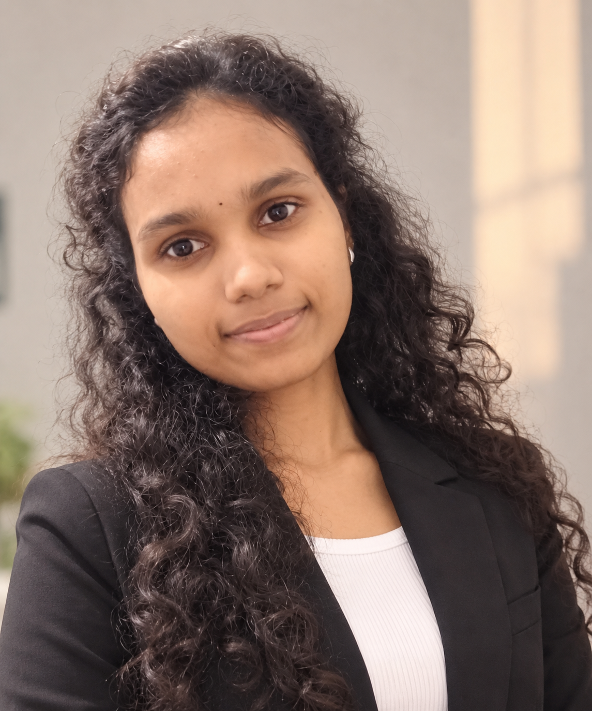

<!--
  KAVINAYA P | FUTURISTIC EEE PORTFOLIO
  GitHub Profile README
  Theme: Midnight Black + NVIDIA Green + Electric Blue
-->

<!-- HERO BACKGROUND -->

<h3>Electrical & Electronics Engineering Graduate | 2025</h3>

 

 

 

 

---

### ⚡ BUILDING SOLUTIONS FOR A SMARTER, GREENER TOMORROW ⚡

---

## 👩‍💻 About Me

<table>
<tr>
<td width="55%" valign="top">

### Get to Know Me

Electrical and Electronics Engineering graduate from Government College of Engineering, Dharmapuri, with internship experience in Embedded Systems, AI, IoT, and Machine Learning.

I am interested in electrical systems, electronics, embedded development, EV technologies, and industrial automation.

I enjoy learning new technologies, building practical projects, and exploring engineering solutions for real-world problems.

**My interests:**

- Electrical Engineering
- Electronics & Embedded Systems
- EV Technology
- Industrial Automation
- Electrical Design & Testing
- AI Applications in Engineering

</td>
<td width="45%" valign="top">

### Engineering Snapshot

  

  

  

</td>
</tr>
</table>

---

## 🛠️ Technical Skills & Technologies

<table>
<tr>
<td width="23%" valign="middle">

**Programming**

</td>
<td>

</td>
</tr>
<tr>
<td valign="middle">

**Electrical & Electronics**

</td>
<td>

</td>
</tr>
<tr>
<td valign="middle">

**Embedded & IoT**

</td>
<td>

</td>
</tr>
<tr>
<td valign="middle">

**Data Science & AI**

</td>
<td>

</td>
</tr>
<tr>
<td valign="middle">

**Design & Analysis Tools**

</td>
<td>

</td>
</tr>
<tr>
<td valign="middle">

**Other Tools**

</td>
<td>

</td>
</tr>
</table>

---

## 🚀 Featured Projects

### REAL-WORLD ENGINEERING PROJECTS

<table>
<tr>
<td width="33%" valign="top">

### 🚗 EV Fire Accident Prevention

**Multi-Fault Detection**

An IoT-based EV safety system designed to detect overheating, gas leakage, and voltage drop with AI-based fault prediction logic.

**Focus:** EV Safety | Embedded Systems | IoT

[View Project](YOUR_EV_PROJECT_URL)

</td>
<td width="33%" valign="top">

### 💧 Water Quality Analysis

**Using Artificial Intelligence**

Machine learning model to analyze and predict water contamination levels using chemical and physical parameters.

**Focus:** AI | Data Analysis | Environmental Monitoring

[View Project](YOUR_WATER_PROJECT_URL)

</td>
<td width="33%" valign="top">

### 🌍 Seismic Hazard Assessment

**Machine Learning Model**

ML model to predict seismic hazard intensity using real datasets and model tuning.

**Focus:** Machine Learning | Data Science | Hazard Assessment

[View Project](YOUR_SEISMIC_PROJECT_URL)

</td>
</tr>
</table>

---

## 💼 Internship Experience

<table>
<tr>
<td width="50%" valign="top">

### 🔌 NSIC Technical Service Centre

**Embedded Systems with AI and IoT Intern**

`July 2024 – August 2024`

- Arduino and Raspberry Pi
- Embedded Systems
- Proteus Circuit Simulation
- Circuit Debugging
- Sensors and IoT
- Circuit Design Fundamentals

</td>
<td width="50%" valign="top">

### 🤖 AICTE Edunet Foundation

**Data Science, AI and ML Intern**

`February 2025 – March 2025`

- Machine Learning
- Python and Pandas
- Data Analysis
- Data Visualization
- Classification and Prediction
- Real-world Assignments

</td>
</tr>
</table>

---

## 🏅 Certifications

<table>
<tr>
<td valign="top">

### NPTEL Certifications

- 🟢 Control Systems
- 🟢 Control Engineering
- 🟢 Embedded Systems Design

</td>
<td valign="top">

### Other Certifications

- 🟢 PLC & SIMATIC
- 🟢 Electric Vehicle Design Workshop
- 🟢 Embedded Systems with AI and IoT – NSIC
- 🟢 Project Expo – EV Fault Detection System

</td>
</tr>
</table>

---

## 📄 Resume

---

## 📚 Currently Learning

<table>
<tr>
<td width="50%" valign="top">

### ⚡ Core Electrical

- Electrical Design and Drafting
- Electrical Testing
- Power Systems
- Electrical Machines
- Power Electronics
- Electrical Measurements

</td>
<td width="50%" valign="top">

### 🔌 Embedded & Automation

- PLC Fundamentals
- SCADA Fundamentals
- Embedded C
- Microcontroller Programming
- MATLAB / Simulink
- Industrial Automation

</td>
</tr>
</table>

---

## 🎯 Career Interests

---

## 📊 GitHub Statistics

---

## 🌐 Connect With Me

---

 

**Exploring Engineering Today for a Smarter, Greener Tomorrow.**

